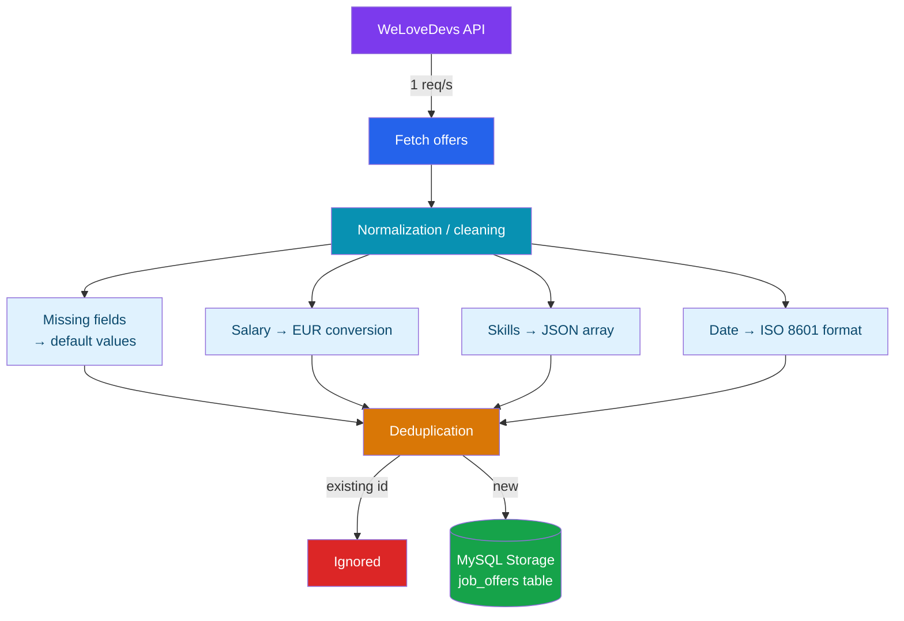

# ADR-DATA — Data Collection and Integration Strategy

**Date :** 05/05/2026
**Status :** Accepted

---

## Context

The project requires a real-world data source for tech job offers.
The requirements mandate the integration of the WeLoveDevs API as a compulsory source,
with a rate limit of 1 request/second/student.
Data must be normalized before storage to ensure
data model consistency.

---

## Why

Without a real data source, the platform has no value for
users. WeLoveDevs provides recent tech offers in France
that are relevant to our target audience (junior developers and
Epitech students). Normalization is necessary because
external data can be incomplete or poorly formatted.

---

## How

### Primary source — WeLoveDevs API

- Integration via the WeLoveDevs REST API (OpenAPI 3.0)
- API key obtained via [https://epi-api.welovedevs.com/ask-for-api-key/](https://epi-api.welovedevs.com/ask-for-api-key/)
- Manual ingestion trigger via a dedicated endpoint
- Rate limit managed with a 1 req/s queue

### Ingestion pipeline



### Normalized data model

Each stored offer contains:

- `id` — unique identifier
- `title` — job title
- `description` — full description
- `company_id` — company reference
- `salary_min` / `salary_max` — salary range
- `currency` — currency (EUR by default)
- `remote_type` — remote / hybrid / onsite
- `skills` — JSON array of skills
- `experience_years` — required years of experience
- `created_at` — publication date

### Rate limit management

```js
// 1-second wait between each request
const delay = (ms) => new Promise((resolve) => setTimeout(resolve, ms));
for (const offer of offers) {
  await fetchAndStore(offer);
  await delay(1000);
}
```

---

## Trade-off

| Advantage                           | Disadvantage                                       |
| ----------------------------------- | -------------------------------------------------- |
| Real and recent data                | Dependency on an external API                      |
| Targeted French tech offers         | 1 req/s rate limit slows down ingestion            |
| Official Epitech partnership        | API key linked to @epitech.eu address              |
| Normalization guarantees consistency| Possible loss of data specific to WeLoveDevs       |

---

## Rejected alternative

### Web scraping

**Why rejected:** Illegal without authorization, fragile (depends on HTML),
blocked by anti-bot protections. The WeLoveDevs partnership provides
an official and stable API — scraping adds no value
and creates legal risks.

### Static / mock data

**Why rejected:** The project explicitly mandates real data.
Mocked data does not allow for demonstrating the ingestion pipeline
nor the product value for users.

---

## References

- API doc : [https://epi-api.welovedevs.com/](https://epi-api.welovedevs.com/)