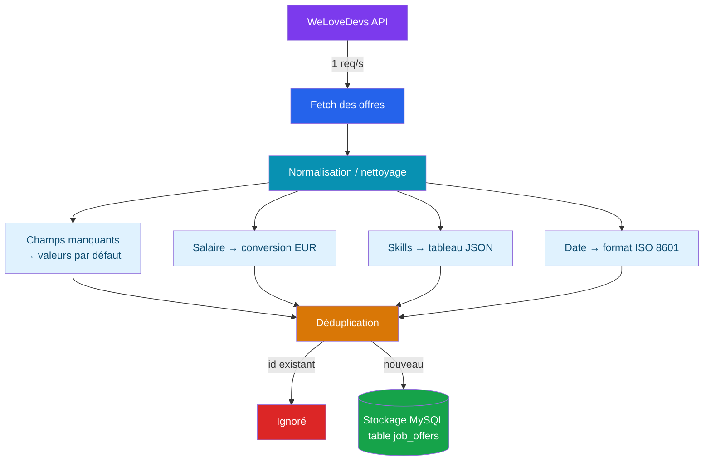

# ADR-DATA — Stratégie de collecte et d'intégration des données

**Date :** 05/05/2026
**Statut :** Accepté

---

## Contexte

Le projet nécessite une source de données réelle d'offres d'emploi tech.
Le sujet impose l'intégration de l'API WeLoveDevs comme source obligatoire,
avec un rate limit de 1 requête/seconde/étudiant.
Les données doivent être normalisées avant stockage pour garantir
la cohérence du modèle de données.

---

## Why

Sans source de données réelle, la plateforme n'a pas de valeur pour
les utilisateurs. WeLoveDevs fournit des offres tech françaises
récentes et pertinentes pour notre cible (développeurs juniors et
étudiants Epitech). La normalisation est nécessaire car les données
externes peuvent être incomplètes ou mal formatées.

---

## How

### Source principale — WeLoveDevs API

- Intégration via l'API REST WeLoveDevs (OpenAPI 3.0)
- Clé API obtenue via https://epi-api.welovedevs.com/ask-for-api-key/
- Déclenchement manuel de l'ingestion via un endpoint dédié
- Rate limit géré avec une file d'attente de 1 req/s

### Pipeline d'ingestion



### Modèle de données normalisé

Chaque offre stockée contient :

- `id` — identifiant unique
- `title` — intitulé du poste
- `description` — description complète
- `company_id` — référence entreprise
- `salary_min` / `salary_max` — fourchette salariale
- `currency` — devise (EUR par défaut)
- `remote_type` — remote / hybrid / onsite
- `skills` — tableau JSON de compétences
- `experience_years` — années d'expérience requises
- `created_at` — date de publication

### Gestion du rate limit

```js
// Attente de 1 seconde entre chaque requête
const delay = (ms) => new Promise((resolve) => setTimeout(resolve, ms));
for (const offer of offers) {
  await fetchAndStore(offer);
  await delay(1000);
}
```

---

## Trade-off

| Avantage                            | Inconvénient                                       |
| ----------------------------------- | -------------------------------------------------- |
| Données réelles et récentes         | Dépendance à une API externe                       |
| Offres tech françaises ciblées      | Rate limit de 1 req/s ralentit l'ingestion         |
| Partenariat officiel Epitech        | Clé API liée à l'adresse @epitech.eu               |
| Normalisation garantit la cohérence | Perte possible de données spécifiques à WeLoveDevs |

---

## Alternative rejetée

### Scraping web

**Pourquoi rejeté :** Illégal sans autorisation, fragile (dépend du HTML),
bloqué par les protections anti-bot. Le partenariat WeLoveDevs offre
une API officielle et stable — le scraping n'apporte aucune valeur ajoutée
et crée des risques légaux.

### Données statiques / mock

**Pourquoi rejeté :** Le sujet impose explicitement des données réelles.
Des données mockées ne permettent pas de démontrer le pipeline d'ingestion
ni la valeur produit pour les utilisateurs.

---

## Références

<!-- - Code : `controllers/jobController.js` -->
<!-- - Pipeline : `services/ingestionService.js` -->

- API doc : https://epi-api.welovedevs.com/
