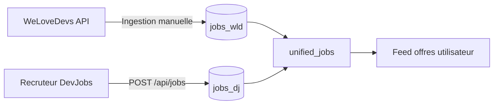

# ADR-PRODUCT — Décisions produit de la plateforme DevJobs

**Date :** 13/05/2026
**Statut :** Accepté

---

## Contexte

Le projet consiste à construire un job board centré sur les développeurs,
en agrégeant des offres externes (WeLoveDevs) et en permettant aux
recruteurs de publier leurs propres offres. La plateforme doit adresser
deux types d'utilisateurs aux besoins très différents : les développeurs
juniors en recherche d'emploi, et les recruteurs cherchant à toucher
ce public.

Les plateformes existantes (LinkedIn, Indeed) sont généralistes et
inadaptées aux développeurs juniors : interfaces complexes, offres
"junior" exigeant 2+ ans d'expérience, processus de candidature lourd.

---

## Why

### Utilisateurs cibles

**Lucas** — Développeur junior (21 ans, fin de formation)
- Perdu sur les plateformes généralistes
- Veut des offres honnêtes et adaptées à son niveau
- Cherche un processus de candidature simple et rapide

**Sarah** — Fondatrice de startup (34 ans)
- Pas de département RH dédié
- Veut toucher des profils tech motivés
- Cherche à publier des offres rapidement et à suivre les candidatures

Sans un espace dédié à chaque rôle, la plateforme ne peut pas répondre
efficacement aux besoins de ces deux personas aux attentes opposées.

---

## How

### Décision 1 — Deux espaces distincts

La plateforme est divisée en deux expériences séparées selon le rôle :

**Espace chercheur d'emploi (Lucas)**
- Feed d'offres agrégées (WeLoveDevs + offres DevJobs)
- Sauvegarde d'offres pour les consulter plus tard
- Candidature en un clic depuis la fiche offre
- Tableau de bord des candidatures avec suivi

**Espace recruteur (Sarah)**
- Publication d'offres d'emploi directement sur la plateforme
- Tableau de bord des offres publiées par l'entreprise
- Consultation des candidatures reçues par offre

### Décision 2 — Agrégation d'offres WeLoveDevs

Les offres WeLoveDevs sont ingérées via leur API officielle et stockées
dans la base de données locale (`jobs_wld`). Les offres publiées
directement par les recruteurs sont stockées dans `jobs_dj`.
Une vue unifiée (`unified_jobs`) expose les deux sources au front.

### Décision 3 — Système de candidature

Un utilisateur peut postuler à n'importe quelle offre (WeLoveDevs ou
DevJobs) depuis la fiche offre. La candidature est enregistrée dans
la table `applications` avec la source (`wld` ou `dj`) pour permettre
le suivi différencié.

Routes :
- `POST /api/applications` — postuler
- `GET /api/applications` — liste de mes candidatures
- `GET /api/applications/:id` — détail d'une candidature

### Décision 4 — Sauvegarde d'offres

Les utilisateurs peuvent sauvegarder des offres pour les consulter
plus tard, sans postuler immédiatement. Ce système réduit la friction
du parcours utilisateur en séparant la phase de découverte de la phase
de candidature.

Routes :
- `POST /api/saved-jobs` — sauvegarder une offre
- `DELETE /api/saved-jobs/:id` — retirer une offre sauvegardée
- `GET /api/saved-jobs` — liste des offres sauvegardées

---

## Trade-off

| Décision | Avantage | Inconvénient |
|----------|----------|--------------|
| Deux espaces distincts | Expérience adaptée à chaque rôle | Plus de pages à développer et maintenir |
| Agrégation WeLoveDevs | Contenu immédiat sans effort de publication | Dépendance à une API externe, données en lecture seule |
| Candidature en base | Suivi côté recruteur possible | Nécessite une authentification, pas de candidature anonyme |
| Sauvegarde d'offres | Réduit la friction de candidature | Données supplémentaires à stocker par utilisateur |

---

## Alternative rejetée

### Plateforme généraliste (tous secteurs)

**Pourquoi rejeté :** Les plateformes généralistes (Indeed, LinkedIn)
souffrent d'un excès d'offres non pertinentes pour les développeurs.
Se spécialiser sur les profils tech permet de mieux cibler les offres
et de construire une communauté cohérente.

### Candidature par email uniquement

**Pourquoi rejeté :** Un système de candidature par email ne permet
pas de suivi centralisé, ni de tableau de bord pour le recruteur.
La valeur produit repose sur la capacité à suivre et gérer les
candidatures depuis la plateforme.

---

## Références

- Personas : `Docs/persona.md`
- Analyse concurrentielle : `Docs/recruitment-space.md`
- Schéma base de données : `Docs/init.md`
- Routes candidatures : `Backend/routes/candidatureRoutes.js`
- Routes offres : `Backend/routes/jobRoutes.js`
- Routes sauvegarde : `Backend/routes/savedJobRoutes.js`
