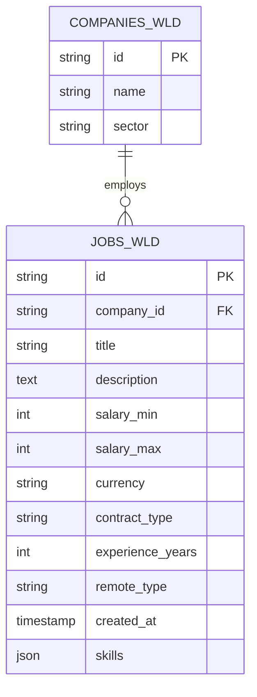
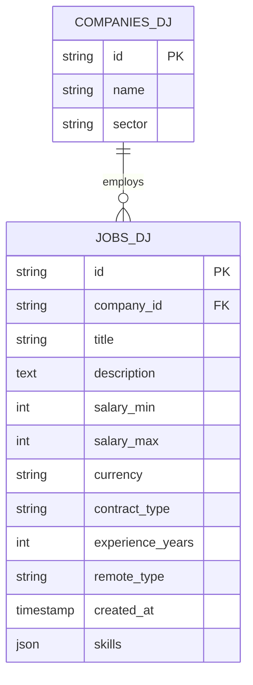

## Database Creation

The objective is to design a database capable of storing all the necessary information for our job board platform.

This database was built using the We Love Dev API provided in the project brief. The API returns a JSON file detailing the standard structure of a job posting on their site. This includes comprehensive information about the hiring company, as well as descriptions of the expectations for a typical candidate profile.

The structure of a We Love Dev job offer is represented in the database schema below:




As shown, we extract the core data. For companies, we store the name and business sector. For job postings, we capture more detailed information such as the job title, a short description, and a salary range (minimum and maximum). We also include the currency, required years of experience, the posting date, and the specific skills required (along with the number of years of mastery expected for each).

After building this initial structure, we developed the specific tables for our own site, DevJobs. This new structure is based on the original We Love Dev data but has been refined—adding or removing fields—to better align with our site's specific features and ensure a more personalized, optimized experience. The structure is organized as follows:
Code snippet


Finally, our database includes an authentication table. This is designed to support different types of users, including recruiters, job seekers, and administrators responsible for site maintenance and updates. The schema for this table is presented below:


```mermaid
erDiagram
    USERS {
        int id PK
        string firstname
        string name
        string email
        string password
        enum role
        timestamp created_at
    }