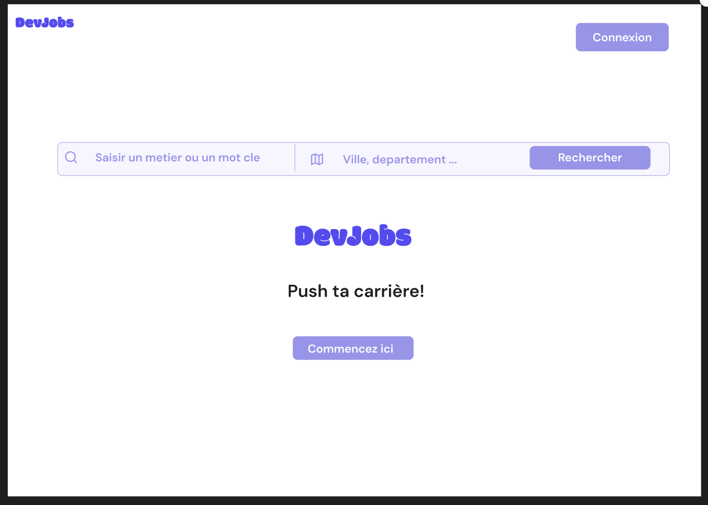
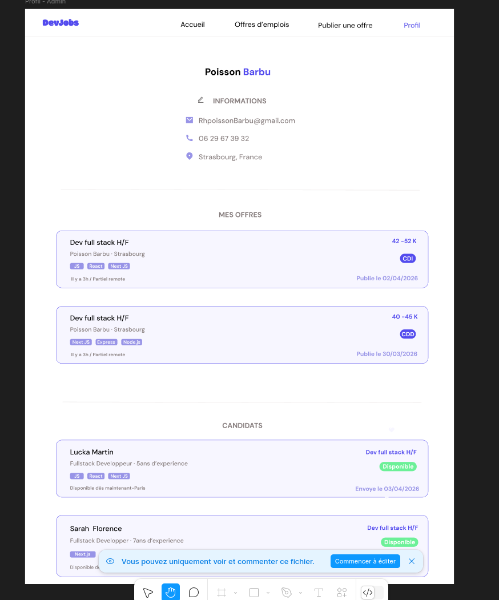
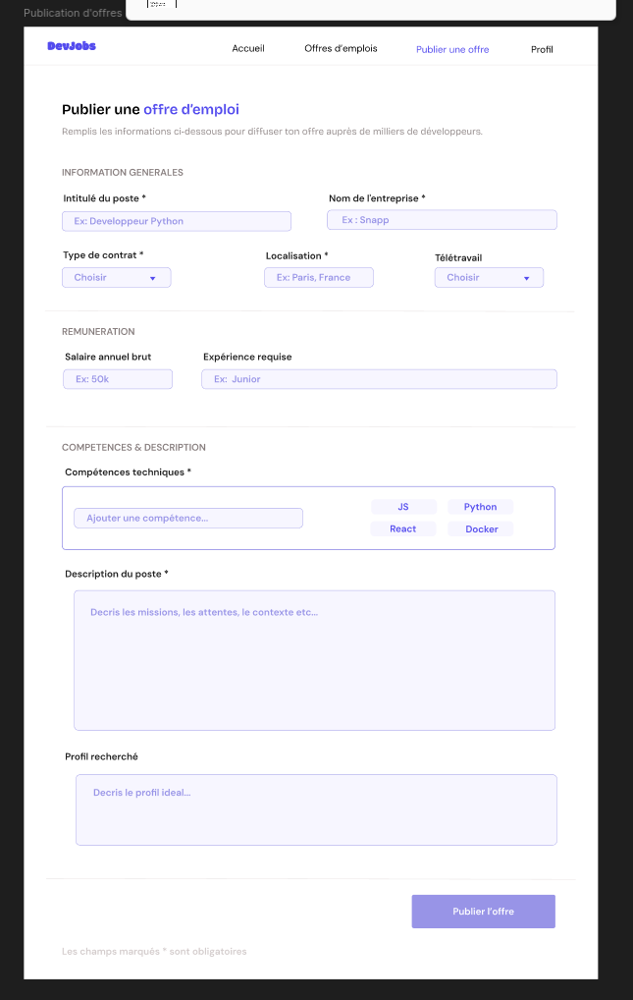
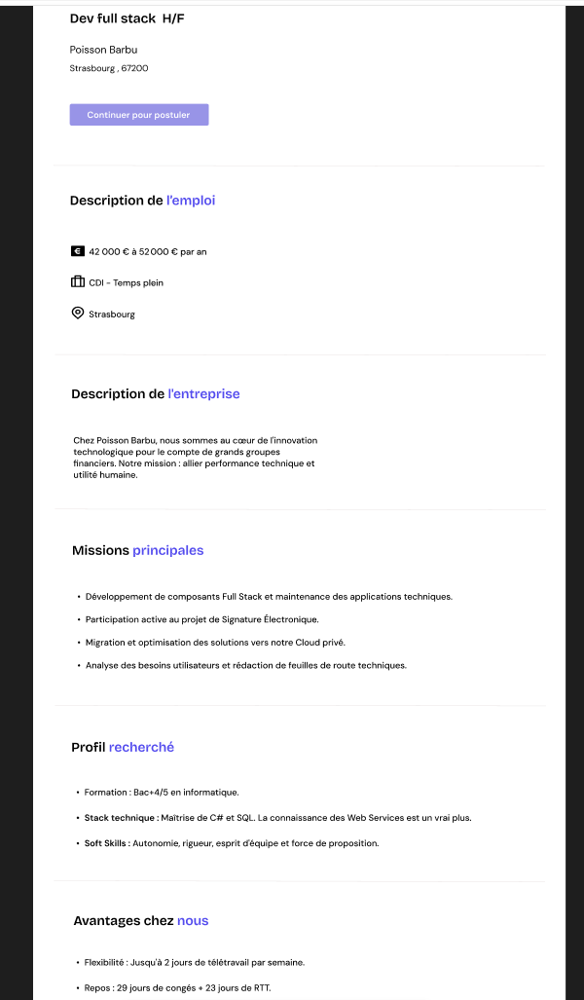
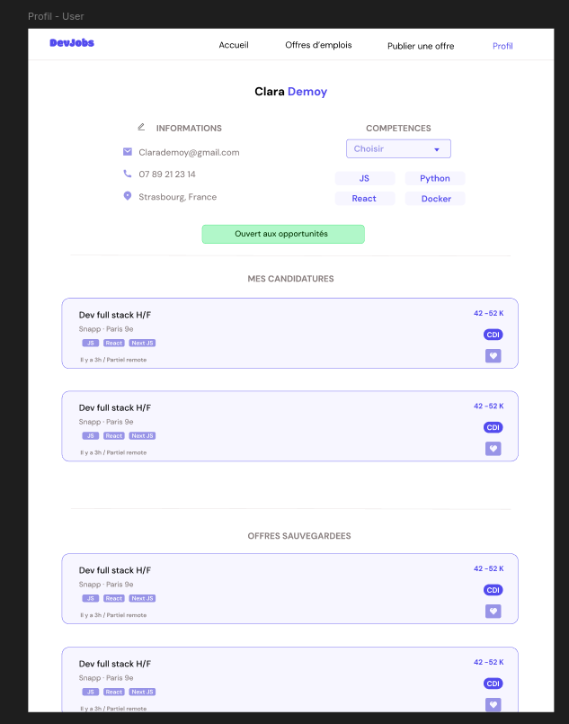
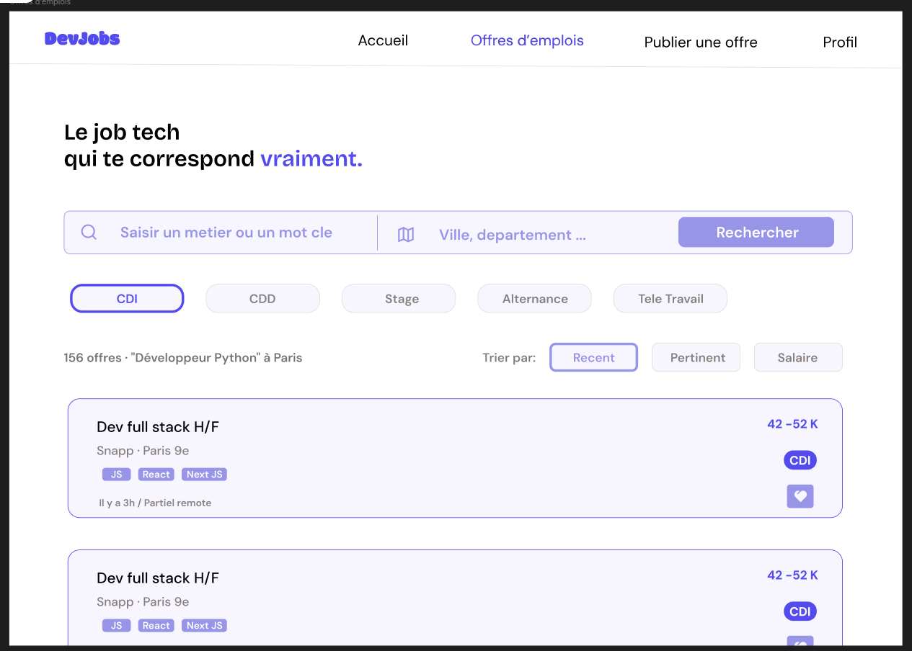
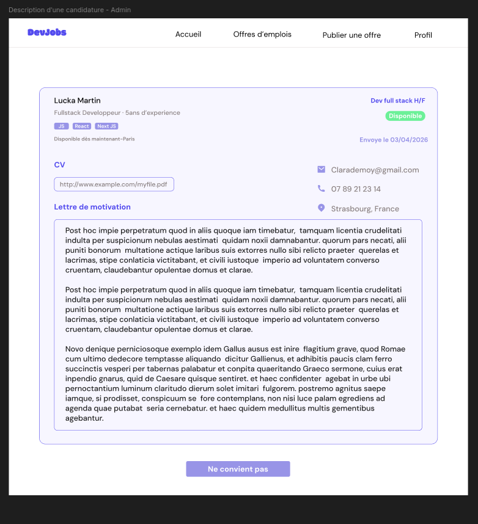
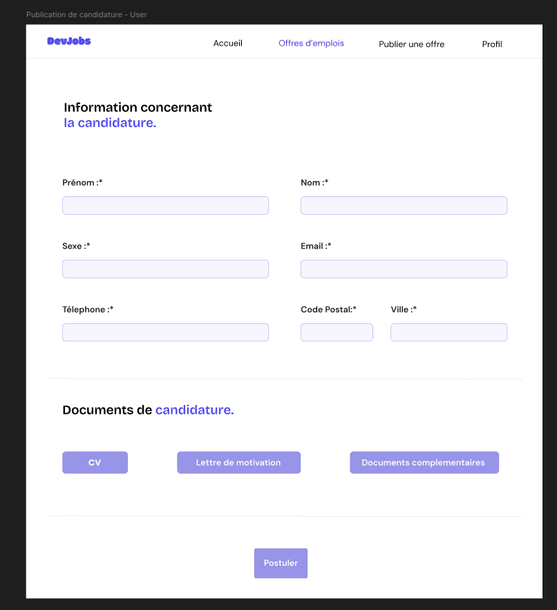

# Page des Wireframes

La page d'accueil a été pensee pour etre epurer sans trop surchargé d'information les utilisateurs du site web. Son nom DevJobs(pour trouver du travail dans le monde du développement).Des couleurs harmonieuses qui n'attaquent pas trop la vision. On peut retrouver sur la page un bouton pour se connecter à son profil. Egalement une barre de recharches poyr trouver du travail dans sa region et dans le secteur d'activité que nous cherchons. Petit message motivant aussi au milieu de la page avec le slogan "Push ta carrière"

Ici nous arrivons sur la page profil admin faite plus précisement pour les entreprises qui mettent en ligne des offres et peuvent avoir un viseul sur les offres postées mlais également un autre visuel sur les candiatures aux diférentes offres. Niveau couleur toujours le même esprit que sur la page d'accueil sans surcharge les utilisateurs. Ils peuvent également voir le résumé de leur progil avec le nom, telephone, mail et emplacement et aussi une possibilité de changer les infos. une description des offres et aussi des candidats et les skills techniques des candidats. Il y'a egalement une navbar que permet de revenir a l'accueil aux offres ou encore la possibilité aux entreprises de publier une offre. 

Ici nous retrouvons la page dédier à la publication d'offre spécialement faite pour les entreprises. Ils ont une visualisation claires des informations a remplir pour que la descritpion du poste soit complète. Ce qui signifie : le nom du poste, nom de l'entreprise, le type de contrat, la localisation et si il y'a une possibilité de faire du teletravail. ensuite un espace concernant la remuneration du poste ainsi que l'expérience requise pour ce job. Un espace pour mettre en avant quelles compétences techniques le recruteur voudrait vraiment chez un employé. Un endroit également pour faire une decription du poste les attentes et ce que le candidat serait ammener a faire durant sa prise de poste. Et enfin une description facultative du profil type recherché et un bouton pour publier cette offre afin qu'elle soit visible pour tous ceux qi recherche un job qui rentre en accord avec ce que porpose cette offre.

Lorsque cette entreprise aura publier son offre elle apparaitra sur les compte des utilisateurs qui recherchent un travzi. Elle apparaitra alors sous cette forme : nom du poste, nom de l'entreprise et lieu comme renseignée auparant par l'entreprise. Une courte description de du poste avec les informations les plus importantes.Un résumé du poste, les missions principales que le candidat serait ammener à faire. L'espace du profil rechc=erché renseigner par l'entreprise et enfin une section avanatge pour donner envie au candidat de postuler et de pouvoir se positionner par rapport aux autres annonces qu'il a pu voir qui auraient surelent le même descriptif. 

Venont ensuite sur le point de quelqu'un qui cherche du travail, son profil sera légèrement différent par rapport a celui du recruteur, il pourra egalement remplir ces informations mais aussi ajouter les compétences techniques qu'il possède pour que lors des candidatures celles ci soit mises en avant. il peut egalement avoir une visualtion des candidatures qu'ils auraient dejà effectuees et aussi une vision des offfres qu'il garde poru pljus tard. Il peut aussi lettre qu'il est a=ouvert aux oppurtunités avec cette fonctionnalités sur le profil.

Aprsè avoir renseigné ces informations sur son compte il pourra aller voir les offres d'emplois disponibles, regarder selon les types de contrats, tier par ordre : si l'offre est plus récent ou moins et des petits reésumé pour chaque offres d'emplois, également un bouton pour pouvoir lettre des offres interresantes en favoris pour les garder sur son prorfil et candidater plus tard ou se renseigner sur le poste de manière plus poussée. 

